<p align="center">
  
</p>

<h1 align="center">isokit</h1>

<p align="center"><b>Explain how your product works in one sentence. Get an animated diagram for your landing page.</b><br>
A Claude Code skill that turns one sentence about your system into an animated isometric diagram: plain SVG with a 1.7 kB player, no dependencies, yours to edit.<br>
<a href="https://ga-mo.github.io/isokit/">Live showcase</a> · <a href="#install">Install</a> · <a href="#use">Use</a> · <a href="#the-kit">The kit</a> · <a href="#numbers">Numbers</a></p>

It is not an animation library or a hosted service. You describe how your product works in a sentence. The `iso` skill storyboards it into three to six beats from measured motion recipes and draws it with a small kit: rounded slabs, wires that draw themselves, light pulses, text, and a loop that returns to its first frame. The scene is plain SVG with CSS and WAAPI motion. It needs no animation library, pauses off screen and shows a still frame for reduced motion. The image above is the showcase hero: four sentences typed to Claude, each drawn as its own diagram in its own material and colour, and the pieces of one lift away as the next one drops in. The kit exports all four as one SVG that animates with CSS alone, so it plays right here in the README. Paste a scene like it into a landing page hero, a docs page, a pitch deck or a README.

## Gallery

Every image here is a real scene from `skill/examples/`, written by `exportSvg()` into `docs/svg/`. The [showcase](https://ga-mo.github.io/isokit/) plays 44 explainers grouped by what they explain (how data flows, how it scales, what's inside, before and after, pick one, who talks to whom), each headed by the prompt behind it, and shows four of them inside made-up pages.

It also draws small spot illustrations for feature lists and empty states, seven of them on the showcase. Three of them:

<table>
  <tr>
    <td width="33%"></td>
    <td width="33%"></td>
    <td width="33%"></td>
  </tr>
</table>

Every scene also ships a phone copy that tells the same story re-composed for a narrow screen. This is the hero's:

<p align="center"></p>

<p></p>

Eight of the 49 side finishes, from all six families: metal, glass, natural, tech pattern, retro and generative. Generative finishes take a seed, and the same seed always draws the same pattern. [See all 49 on the showcase](https://ga-mo.github.io/isokit/#materials).

## What you get

| Feature | What it does |
|---|---|
| A storyboard first | The skill writes the beats (what moves, when, how long) before it draws, from recipes measured frame by frame: arrivals, hand-offs, pulses, slot stacks, fills |
| Phone and desktop | Every scene ships a compact (390 wide) and a wide copy. They switch on the width of their own container, so a scene also works in a narrow column |
| No animation library | SVG, HTML text, CSS and WAAPI. The runtime is 1.7 kB gzip |
| Calm by default | Plays when scrolled into view, pauses off screen, drops its animations far off screen, shows a still that tells the whole story under reduced motion |
| Labels that never overflow | Text has a 13 px floor on phones, and `fitX()` keeps each label inside its scene at the narrowest width it will be shown |
| Readable text, checked | `skill/scripts/contrast.mjs` measures every text in every scene against the pixels behind it at five moments; CI fails under 4.5:1. The kit throws when a side label would sit on a face nobody can see |
| Boxes first, then wires | The kit finds the boxes each wire joins, grows the wire only once they have landed, runs its pulse after that and retracts it before they leave. `skill/scripts/order.mjs` seeks every scene every 50 ms (25,100 frames over the showcase, hero and contexts); CI fails on any frame with a wire or pulse ahead of its boxes. Before the kit did this, 1,587 frames of 22,980 did |
| Six compositions | Wide strips, diagonal rows, upright panels, radial cores, high fields and exploded stacks, plus single objects for feature lists |
| Scenes you can play | A switch that steps a rollout, a slider that drives load (mouse and touch), parts you click to drill into |
| 49 side finishes | Metal, glass, natural, tech pattern, retro and seeded generative paints that bend round the slab's rounded corner as one line |
| `exportSvg()` | Writes a scene as one SVG animated with CSS `@keyframes` alone, no script, for READMEs, docs and email |
| `mountLazy()` | Mounts many scenes on one page as they scroll near the screen, fetching only the compact or wide copy that fits |
| Checks its own work | Render, screenshot at 393, 768, 1280 and 1440, strict types and a frame-time benchmark, all in `skill/scripts/` |

## Install

```sh
npx skills add GA-MO/isokit
```

That is the whole install for most agents. The [skills CLI](https://github.com/vercel-labs/skills) finds the `iso` skill in this repo, asks which of your agents should get it, and asks whether to install it for you (`-g`) or for the current project only. It needs Node 22.20 or later. To skip the questions, name the agents: `npx skills add GA-MO/isokit -g -a claude-code codex -y`. The CLI sends anonymous usage data unless you set `DISABLE_TELEMETRY=1`.

| Agent | `-a` | With `-g`, lands in |
|---|---|---|
| Claude Code | `claude-code` | `~/.claude/skills/iso` |
| Codex, Cursor, Gemini CLI, GitHub Copilot, opencode, Amp | `codex`, `cursor`, `gemini-cli`, `github-copilot`, `opencode`, `amp` | `~/.agents/skills/iso` |
| Devin, goose, Junie, Kiro | `devin`, `goose`, `junie`, `kiro-cli` | each agent's own folder, linked to `~/.agents/skills/iso` |

Antigravity reads `.agents/skills` only inside a project, so install it there (`npx skills add GA-MO/isokit -a antigravity`) or copy the folder to `~/.gemini/config/skills/iso` as [docs/install.md](docs/install.md#antigravity) shows. Update with `npx skills update`.

### Claude Code plugin, if you want updates delivered

```sh
claude plugin install iso --marketplace GA-MO/isokit
```

This adds the `isokit` marketplace and installs the `iso` plugin from it (Claude Code 2.1.275 or later; inside a session, `/plugin marketplace add GA-MO/isokit`, then `/plugin install iso@isokit`). The skill is then `/iso:iso`. Claude Code leaves auto-update off for marketplaces you add yourself. Turn it on in `/plugin` > Marketplaces > `isokit` > Enable auto-update, or run `claude plugin update iso@isokit`. Use either this or `npx skills add` in Claude Code, not both, or you end up with two copies of the skill.

### Claude app (claude.ai and the desktop app)

1. Turn on code execution: Settings > Capabilities > Code execution and file creation (Create and edit files in the newer settings). On Team and Enterprise plans, an owner turns on Skills under Organization settings > Plugins & skills > Policy.
2. Download [`iso.zip`](https://github.com/GA-MO/isokit/releases/latest/download/iso.zip) from the latest release, or build the same file from a clone with `sh scripts/zip.sh` ([docs/install.md](docs/install.md#claude-app-claudeai-and-the-desktop-app)).
3. Open Customize > Skills, click `+`, then `+ Create skill`, then `Upload a skill`, and choose `iso.zip`. Turn `iso` on.

To update, upload the newer `iso.zip` from the next release.

### What the skill needs to run

Rendering a scene needs only Node 22.18 or later (or 23.6 or later), or Bun. The first time a check runs, it installs Playwright and TypeScript into the skill's own `scripts/node_modules`, never globally. Screenshots and checks use your installed Google Chrome; without it, Playwright downloads its own Chromium into that folder. Where there is no network, as in skills on the Claude API, a check says it was skipped and exits with code 2, and the rendered page is still good.

Manual installs for every agent (clone and copy, project folders, how to check the skill loaded) are in [docs/install.md](docs/install.md). Every path and command there and here was checked against each tool's official docs on 2026-11-10; the pages are listed in [docs/install-sources.md](docs/install-sources.md).

## Use

Ask your agent for a scene in plain words, for example:

> Draw one event fanning out to email, push and SMS, each channel lighting up as it receives it.

The skill reads `skill/SKILL.md` and `skill/recipes.md`, writes a scene module, renders it with `skill/scripts/render.ts`, takes screenshots at phone and desktop widths, and fixes what looks off. Every card on the showcase shows the prompt behind its scene.

To render an example yourself:

```sh
cd skill
node scripts/render.ts examples/notifications.ts out/notifications.html
node scripts/shots.mjs page=out/notifications.html times=0,1,2 loop=1 widths=393,1280 out=out/shots
```

## The kit

`skill/lib/iso.ts` builds scenes at build time and has no dependencies. `skill/lib/runtime.ts` plays them in the browser.

```ts
import { Scene, responsive, lazyBox } from './skill/lib/iso';
import { mountAll, mountLazy } from './skill/lib/runtime';

const s = new Scene({ name: 'deploy', width: 720, height: 400 });
s.slab({ id: 'build', at: [0, 0, 0], size: [120, 120], height: 28, top: '#1b1c22', side: { kind: 'flat', color: '#5b21b6' } });
s.dropIn('build', 0.1);
s.loop(6, 2.2);

s.render();      // HTML for a page: SVG, labels and the motion spec
s.exportSvg();   // one standalone SVG, animated with CSS @keyframes, no script
```

- Inline scenes: put `responsive(compact, wide)` on the page and call `mountAll()` once.
- Many scenes on one page: write each `scene.render()` to its own file at build time, put `lazyBox(compact, wide, breakpoint)` where it goes, and call `mountLazy({ src: name => '/scenes/' + name + '.html' })`. Each box reserves its height, and only the copy that fits its width is fetched when it nears the screen. The showcase works this way.
- `exportSvg()` needs every piece of text drawn with `text()`. It throws on an HTML `label()` and names it.

`skill/SKILL.md` has the whole API, the visual rules and the Astro setup.

## What is in `skill/examples/`

There are 51 scenes for fictional products: 44 explainers and 7 spot illustrations. Each explainer has an `intent`, the question it answers and the showcase group it sits in (`flow` how data flows, `scale` how it scales, `inside` what's inside, `change` before and after, `choose` pick one, `talk` who talks to whom), and an `ask`, the short prompt that heads its card. Every scene is tagged with one of seven layouts. Most scenes sit on the light surface; at most one in five uses the `night` surface (a deep indigo backdrop with coloured sides and glow), and none uses a plain dark one.

| Layout | Composition | Scenes |
|---|---|---|
| wide | a long strip read left to right, shown as a full-width card at about 3:1 | CI/CD, ETL, queue and workers, a live funnel, a billing cycle, parcel delivery, test shards |
| diagonal | a long row along an iso axis | database branching, edge cache, a firewall, blue-green, snapshot restore, retrieval-backed answer, training loss, a re-ranking shelf, stock sync |
| panels | upright panels facing each other | sign-in with 2-step, live cursors, two approvals, one message in six languages (Thai included) |
| radial | a core with things on a ring | notifications, agent tools, payments, observability, key rotation, health checks, DNS, cron, A/B test, a smart home scene |
| field | a wide field or grid from high up | file upload, a service map you can hover, search index, a flag rollout you can play, a scheduler, embeddings, build cache, calendar booking, a load slider you can drag |
| exploded | layers lifted apart | an audit ledger, video transcoding, a fraud gauge, data lineage, a system you click to drill into |
| object | one or two objects | a keycard reader, a sync loop, a filling inbox, a charging battery, a table scan, a tile loader, an empty box |

There is also the hero (four stories in `examples/hero/` that the showcase plays in turn, and `readme()` joins them with a terminal card into one looping SVG), four `inContext` copies the showcase plays inside made-up pages, and the 49 side finishes in `materials-*.ts` with one gallery per family in `material-gallery.ts`. Slab sides use the `paints` in `shared.ts` (gradient, brushed metal, stripes, dots, glass, a seeded random mosaic and flat colour).

## Numbers

All numbers were measured on 2026-11-08 on an Apple silicon Mac with Chrome, the hero's on 2026-11-09, the showcase page and scene files on 2026-11-10. 1 kB = 1024 bytes.

| What | Raw | Gzip |
|---|---|---|
| Showcase `index.html` (the hero's first story inline, 60 empty scene boxes, folded prompts, the install tabs) | 430.7 kB | 44.0 kB |
| Showcase CSS | 36.4 kB | 7.5 kB |
| Showcase JS bundle (runtime, `mountLazy()`, the site's retry note) | 6.5 kB | 2.7 kB |
| Hero script (story order, prompt chips, lift-off, tilt) | 8.3 kB | 3.6 kB |
| Showcase inline JS (copy buttons, prompt toggles, filter, install tabs, flag, slider and drill-down demos) | 14.8 kB | 4.2 kB |
| All 117 scene files in `site/dist/scenes/` (compact and wide copies, the hero's other three stories, plus the README context as one standalone SVG) | 12920.9 kB | 1008.9 kB |
| Largest scene file (`embed-lg.html`) | 389.8 kB | 21.8 kB |
| Scene runtime alone (`skill/lib/entry.ts`, `mountAll()`) | 4.2 kB | 1.7 kB |
| Runtime with `mountLazy()` | 5.7 kB | 2.3 kB |
| `docs/svg/hero.svg` (the image at the top, all four stories) | 222.6 kB | 21.1 kB |

The page does not grow with the number of scenes. Each card holds an empty box that keeps its height. When the box comes within 75 % of a screen height of the viewport, the page fetches only the copy that fits, compact or wide, and mounts it. A visitor who scrolls the whole page loads one file per box (60) and the hero's other three stories, not all 117.

Hero motion on the built showcase, 20 s of play (three stories and two switches), median of three runs with the range in brackets, alternated run by run with the previous single-story hero. Main-thread time moves with the machine's own load; the frame rate does not. Only the story on screen plays. The other three hold paused and invisible but laid out, so a switch costs no layout pass. Pieces lift and drop by translate and opacity, never by scale, because scaling a group that holds SVG text makes Chrome lay the text out again every frame:

| Viewport, CPU | Frame rate | Frame time p50 / p95 / p99 | Late frames (over 20 ms) | Long tasks | Main thread busy: before → now |
|---|---|---|---|---|---|
| 1280 px, 1x | 60.0 fps | 16.7 / 16.7 / 16.8 ms | 0 | 0 | 9.75 % (9.3 to 10.7) → 10.3 % (9.9 to 11.5), four runs |
| 393 px (phone), 4x | 60.0 fps | 16.7 / 16.8 / 16.8 ms | 0 | 0 | 29.1 % (28.6 to 29.6) → 28.6 % (28.5 to 29.0) |
| 1280 px, 4x | 60.0 fps | 16.7 / 16.7 / 16.8 ms | 0 | 0 | 30.3 % (29.6 to 30.4) → 31.2 % (30.8 to 31.2) |

The whole showcase at rest, after scrolling through it once so every scene has mounted, then stopping at points down the page. Main thread is Chrome's `TaskDuration` per second over 4 s at 1x CPU, alternated with the previous dark showcase (three runs per side at 1280 px, two at 393 px), median with the range in brackets. A scene off screen skips rendering (in browsers with `overflow-clip-margin`, so not Safari) and one more than half a screen away drops its animations, so the cost left is the scenes in view. The two pages differ in layout, so a stop lands on different scenes in each:

| Stop | 1280 px, DPR 2: before → now | 393 px, DPR 3: before → now |
|---|---|---|
| 0 % (hero, four stories now, alternated with the single-story hero) | 13.6 → 11.4 % (9.3 to 11.8) | 12.5 → 11.3 % (10.4 to 13.0, three runs) |
| 20 % | 25.6 → 17.1 % (15.0 to 23.5) | 15.0 to 15.7 → 12.6 to 16.4 % |
| 35 % | 14.3 → 21.7 % (20.0 to 22.5) | 10.9 to 20.6 → 13.7 to 19.4 % |
| 50 % | 17.2 → 16.5 % (14.6 to 21.6) | 16.1 to 19.9 → 15.1 to 18.4 % |
| 60 % | 13.0 → 20.4 % (19.2 to 26.5) | 17.3 to 31.4 → 8.2 to 22.8 % |
| 80 % | 5.5 → 6.3 % (4.1 to 8.9) | 14.2 to 20.4 → 4.5 to 8.5 % |

The worst median is 21.7 % now against 25.6 % before. The page is 28,968 px tall at 1280 and 40,759 px at 393, and the layout shift score stays at 0.0001.

How they were measured:

- Sizes: `bun run build && bun run size` at the repo root. `site/scripts/size.ts` gzips each file in `site/dist` at level 9 and sums the inline module scripts and the scene files.
- Runtime rows: `bun build skill/lib/entry.ts --minify --target browser > out.js`, then `wc -c < out.js` and `gzip -9 -c out.js | wc -c`. The `mountLazy()` row bundles a one-line entry that calls it.
- SVG rows: `bun run readme:svg`, which writes `docs/svg/` and prints each file's size.
- Whole page at rest: `node skill/scripts/page-idle.mjs page=<built showcase URL> width=1280 dpr=2 throttle=1` and `width=393 dpr=3 throttle=1`, run against each build in turn. It scrolls the page through once, then at each stop reads `Performance.getMetrics` over 4 s, and sums layout shift.
- Hero motion: `node skill/scripts/perf.mjs page=<built showcase URL> width=393 throttle=4 seconds=20 selector='#top'` (and `width=1280`, with `throttle=1` and `throttle=4`), run against each build in turn. It counts `requestAnimationFrame` frames, reads long tasks, and takes main-thread time from Chrome's `Performance.getMetrics`.

Fonts are not counted. The site self-hosts Inter and Fira Code as `woff2`. The SVGs in `docs/` fall back to the system's sans and monospace fonts.

## Develop

```sh
bun install          # at the repo root (installs site/)
bun run dev          # showcase dev server
bun run build        # static build into site/dist, served under /isokit/
bun run test         # kit and example tests
bun run readme:svg   # rewrite the animated SVGs in docs/svg/
bun run build:runtime   # rebuild skill/lib/runtime.min.js after editing skill/lib (render.ts inlines it; CI fails when it is stale)
bun run check:contrast  # every text in every scene at 4.5:1 or more (installs skill/scripts deps on first run, uses Chrome)
bun run check:order     # no wire or pulse before the boxes it joins, every 50 ms (installs skill/scripts deps on first run, uses Chrome)
```

Pushing to `main` deploys the site to GitHub Pages through `.github/workflows/pages.yml`. Set the repository's Pages source to GitHub Actions (Settings, Pages) once before the first deploy.

Pushing a tag that starts with `v` (for example `git tag v1.0.0 && git push origin v1.0.0`) runs `.github/workflows/release.yml`, which builds `iso.zip` with `scripts/zip.sh` and attaches it to that tag's GitHub Release. `sh scripts/zip.sh` builds the same file locally.

## License

MIT. See [LICENSE](LICENSE).
