<p align="center">
  
</p>

<h1 align="center">isokit</h1>

<p align="center"><b>Animated isometric explainers, drawn from a prompt.</b><br>
An Agent Skill that turns the story of your product into a looping isometric scene in plain SVG.<br>
<a href="https://ga-mo.github.io/isokit/">Live showcase</a> · <a href="#install">Install</a> · <a href="#use">Use</a> · <a href="#the-kit">The kit</a> · <a href="#numbers">Numbers</a></p>

You describe a product story. The `iso` skill storyboards it into three to six beats from measured motion recipes and draws it with a small kit: rounded slabs, wires that draw themselves, light pulses, text, and a loop that returns to its first frame. The scene is plain SVG with CSS and WAAPI motion. It needs no animation library, pauses off screen and shows a still frame for reduced motion. The image above is the showcase hero, exported by the kit as one SVG that animates with CSS alone, so it plays right here in the README.

## Gallery

Every image here is a real scene from `skill/examples/`, written by `exportSvg()` into `docs/svg/`. The [showcase](https://ga-mo.github.io/isokit/) plays all 64 scenes with their prompts.

<table>
  <tr>
    <td width="33%"></td>
    <td width="33%"></td>
    <td width="33%"></td>
  </tr>
  <tr>
    <td></td>
    <td></td>
    <td></td>
  </tr>
</table>

Every scene also ships a phone copy that tells the same story re-composed for a narrow screen. This is the hero's:

<p align="center"></p>

49 side finishes in six families. Generative finishes take a seed, and the same seed always draws the same pattern.

<p></p>
<p></p>
<p></p>
<p></p>
<p></p>
<p></p>

## What you get

| Feature | What it does |
|---|---|
| A storyboard first | The skill writes the beats (what moves, when, how long) before it draws, from recipes measured frame by frame: arrivals, hand-offs, pulses, slot stacks, fills |
| Phone and desktop | Every scene ships a compact (390 wide) and a wide copy. They switch on the width of their own container, so a scene also works in a narrow column |
| No animation library | SVG, HTML text, CSS and WAAPI. The runtime is 1.5 kB gzip |
| Calm by default | Plays when scrolled into view, pauses off screen, costs nothing far off screen, shows a still that tells the whole story under reduced motion |
| Labels that never overflow | Text has a 13 px floor on phones, and `fitX()` keeps each label inside its scene at the narrowest width it will be shown |
| Readable text, checked | `skill/scripts/contrast.mjs` measures every text in every scene against the pixels behind it at five moments; CI fails under 4.5:1. The kit throws when a side label would sit on a face nobody can see |
| Six compositions | Wide strips, diagonal rows, upright panels, radial cores, high fields and exploded stacks, plus single objects for feature lists |
| Scenes you can play | A switch that steps a rollout, a slider that drives load (mouse and touch), parts you click to drill into |
| 49 side finishes | Metal, glass, natural, tech pattern, retro and seeded generative paints that bend round the slab's rounded corner as one line |
| `exportSvg()` | Writes a scene as one SVG animated with CSS `@keyframes` alone, no script, for READMEs, docs and email |
| `mountLazy()` | Mounts many scenes on one page as they scroll near the screen, fetching only the compact or wide copy that fits |
| Checks its own work | Render, screenshot at 393, 768, 1280 and 1440, strict types and a frame-time benchmark, all in `skill/scripts/` |

## Install

`iso` is an Agent Skill: the `skill/` folder with its `SKILL.md`. Every tool below needs it installed as a folder named `iso`. The skill's render and screenshot checks need [Bun](https://bun.sh) and your installed Google Chrome. Every path and command here comes from each tool's official docs, checked on 2026-11-06; the pages are listed in [docs/install-sources.md](docs/install-sources.md).

### Claude Code

```sh
git clone https://github.com/GA-MO/isokit.git
mkdir -p ~/.claude/skills
ln -s "$PWD/isokit/skill" ~/.claude/skills/iso
cd isokit/skill/scripts && bun install
```

If `~/.claude/skills/iso` already exists, move it away first, or the link lands inside it. Claude Code picks up the skill in a running session. If `~/.claude/skills` did not exist when the session started, run `/reload-skills`. Type `/iso`, or ask `What skills are available?`. For one repo only, copy the folder to `.claude/skills/iso` and commit it. Source: [Claude Code skills](https://code.claude.com/docs/en/skills).

### Claude app (claude.ai and the desktop app)

1. Turn on code execution: Settings > Capabilities > Code execution and file creation (called Create and edit files in the newer settings). On Team and Enterprise plans, an owner turns on Skills under Organization settings > Plugins & skills > Policy.
2. Build `iso.zip` with the `iso` folder at its top level. Every file `unzip -l` lists should start with `iso/`.

   ```sh
   git clone --depth 1 https://github.com/GA-MO/isokit.git
   cd isokit && git archive --format=zip --prefix=iso/ -o ../iso.zip HEAD:skill && cd ..
   unzip -l iso.zip
   ```

3. Open Customize > Skills, click `+`, then `+ Create skill`, then `Upload a skill`, and choose `iso.zip`.
4. Turn `iso` on in Customize > Skills. Then ask for an isometric flow and check that Claude's thinking shows it loading the skill.

Scripts run in Claude's code sandbox, so the Bun checks may not run there. Sources: [Using skills in Claude](https://support.claude.com/en/articles/12512180-using-skills-in-claude), [Create custom skills](https://claude.com/docs/skills/how-to).

### Codex (CLI, IDE extension, ChatGPT desktop app)

```sh
git clone --depth 1 https://github.com/GA-MO/isokit.git
mkdir -p ~/.agents/skills
cp -R isokit/skill ~/.agents/skills/iso
cd ~/.agents/skills/iso/scripts && bun install
```

Codex detects new skills on its own. Restart it if `iso` doesn't show. In the CLI or IDE extension, run `/skills` or type `$`. In the ChatGPT desktop app, open Skills in the sidebar. For one repo, use `.agents/skills/iso`. Source: [Codex skills](https://learn.chatgpt.com/docs/build-skills).

### Cursor

Use the same commands as Codex (`~/.agents/skills/iso`). Restart Cursor, then open Customize in the sidebar and go to Skills, or type `/` in Agent chat. For one repo, use `.agents/skills/iso` (or `.cursor/skills/iso`). Source: [Cursor skills](https://cursor.com/docs/context/skills).

### Gemini CLI

Use the same commands as Codex: Gemini CLI reads `~/.agents/skills` as an alias of `~/.gemini/skills`. In a session, run `/skills reload`, then `/skills list`. From the terminal, run `gemini skills list --all`. For one repo, use `.agents/skills/iso`. Its docs say Antigravity CLI replaced it for unpaid tier and Google One users on 18 June 2026. Source: [Gemini CLI skills](https://geminicli.com/docs/cli/skills/).

### Antigravity (app, CLI, IDE)

```sh
git clone --depth 1 https://github.com/GA-MO/isokit.git
mkdir -p ~/.gemini/config/skills
cp -R isokit/skill ~/.gemini/config/skills/iso
cd ~/.gemini/config/skills/iso/scripts && bun install
```

In the CLI, run `/skills reload` or start a new conversation. In the IDE, open the Customizations menu in the agent side panel. For one repo, use `.agents/skills/iso`. Source: [Antigravity skills](https://antigravity.google/docs/skills).

### GitHub Copilot (CLI, VS Code, cloud agent)

Use the same commands as Codex (`~/.agents/skills/iso`; `~/.copilot/skills/iso` works too).

- Copilot CLI: run `/skills reload`, then `/skills list` in a session, or `copilot skill list` in the terminal.
- VS Code: type `/` in a new chat, run `/skills`, or run Chat: Open Customizations and select Skills.
- Cloud agent: commit the skill to the repo (`.github/skills/iso`, `.claude/skills/iso` or `.agents/skills/iso`), or put it in `.copilot/skills` in your dotfiles repo.

Sources: [About agent skills](https://docs.github.com/en/copilot/concepts/agents/about-agent-skills), [Copilot CLI skills](https://docs.github.com/en/copilot/how-tos/copilot-cli/customize-copilot/add-skills), [VS Code agent skills](https://code.visualstudio.com/docs/copilot/customization/agent-skills).

### Devin Desktop (formerly Windsurf)

Use the same commands as Codex: Devin Desktop reads `~/.agents/skills` next to its own `~/.config/devin/skills`. Click Customize in the agent sidebar and open the Skills tab, or type `/iso`. For one repo, use `.agents/skills/iso` (`.devin/skills` and the legacy `.windsurf/skills` work too). Sources: [Devin Desktop skills](https://docs.devin.ai/desktop/cascade/skills), [Devin Desktop FAQ](https://docs.devin.ai/desktop/devin-desktop-faq).

### opencode

Use the same commands as Codex. opencode also reads `~/.config/opencode/skills` and `~/.claude/skills`. Ask it which skills it can load: it lists them in its `skill` tool. If `iso` is missing, check that no `permission.skill` rule in `opencode.json` denies it. For one repo, use `.agents/skills/iso`. Source: [opencode skills](https://opencode.ai/docs/skills/).

### goose, Amp, Junie, Kiro

goose, Amp and Junie read `~/.agents/skills`, so use the same commands as Codex. Check with `goose skills list`, `amp skills list`, or `/skills` in Junie. Kiro reads `~/.kiro/skills`, and only in the IDE:

```sh
mkdir -p ~/.kiro/skills
cp -R isokit/skill ~/.kiro/skills/iso
```

Then find it under Agent Steering & Skills in the Kiro panel, or type `/` in chat. Sources: [goose](https://goose-docs.ai/docs/guides/context-engineering/using-skills), [Amp](https://ampcode.com/docs/customize/skills), [Junie](https://junie.jetbrains.com/docs/agent-skills.html), [Kiro](https://kiro.dev/docs/skills/).

### Update

Run `git pull` in your clone. If you copied the folder instead of linking it, copy it over again: `cp -R isokit/skill/. ~/.agents/skills/iso/`.

## Use

Ask your agent for a scene in plain words, for example:

> Draw one event fanning out to email, push and SMS, each channel lighting up as it receives it.

The skill reads `skill/SKILL.md` and `skill/recipes.md`, writes a scene module, renders it with `skill/scripts/render.ts`, takes screenshots at phone and desktop widths, and fixes what looks off. Every card on the showcase shows the prompt behind its scene.

To render an example yourself:

```sh
cd skill
bun scripts/render.ts examples/notifications.ts out/notifications.html
node scripts/shots.mjs page=out/notifications.html times=0,1,2 loop=1 widths=393,1280 out=out/shots
```

## The kit

`skill/lib/iso.ts` builds scenes at build time and has no dependencies. `skill/lib/runtime.ts` plays them in the browser.

```ts
import { Scene, responsive, lazyBox } from './skill/lib/iso';
import { mountAll, mountLazy } from './skill/lib/runtime';

const s = new Scene({ name: 'deploy', width: 720, height: 400 });
s.slab({ id: 'build', at: [0, 0, 0], size: [120, 120], height: 28, top: '#1b1c22', side: { kind: 'flat', color: '#5b21b6' } });
s.dropIn('build', 0.1);
s.loop(6, 2.2);

s.render();      // HTML for a page: SVG, labels and the motion spec
s.exportSvg();   // one standalone SVG, animated with CSS @keyframes, no script
```

- Inline scenes: put `responsive(compact, wide)` on the page and call `mountAll()` once.
- Many scenes on one page: write each `scene.render()` to its own file at build time, put `lazyBox(compact, wide, breakpoint)` where it goes, and call `mountLazy({ src: name => '/scenes/' + name + '.html' })`. Each box reserves its height, and only the copy that fits its width is fetched when it nears the screen. The showcase works this way.
- `exportSvg()` needs every piece of text drawn with `text()`. It throws on an HTML `label()` and names it.

`skill/SKILL.md` has the whole API, the visual rules and the Astro setup.

## What is in `skill/examples/`

There are 64 scenes for fictional products at four levels, in four categories (the showcase tabs: Product, Security, Infra, Data & AI), each tagged with one of seven layouts. Every tab has at least one scene at every level.

| Layout | Composition | Scenes |
|---|---|---|
| wide | a long strip read left to right, shown as a full-width card at about 3:1 | CI/CD, ETL, queue and workers, a live funnel, a billing cycle, parcel delivery, test shards |
| diagonal | a long row along an iso axis | database branching, edge cache, a firewall, blue-green, snapshot restore, retrieval-backed answer, training loss, a re-ranking shelf, a kanban card, stock sync, diff to merge, a refund |
| panels | upright panels facing each other | sign-in with 2-step, live cursors, two approvals, design comments, one message in six languages (Thai included) |
| radial | a core with things on a ring | notifications, agent tools, payments, observability, key rotation, data erasure, health checks, DNS, cron, A/B test, CMS publishing, sensors to a gateway, a smart home scene, currency conversion |
| field | a wide field or grid from high up | file upload, a service map you can hover, search index, a flag rollout you can play, zero-trust, a scheduler, autoscaling, embeddings, an OTA rollout, build cache, calendar booking, a load slider you can drag |
| exploded | layers lifted apart | an audit ledger, video transcoding, image sizes, a fraud gauge, data lineage, a system you click to drill into |
| object | one or two objects | a keycard reader, a sync loop, a filling inbox, a charging battery, an alert stack, a table scan, a tile loader, an empty box |

There is also the hero, and the 49 side finishes in `materials-*.ts` with one gallery per family in `material-gallery.ts`. Slab sides use the `paints` in `shared.ts` (gradient, brushed metal, stripes, dots, glass, a seeded random mosaic and flat colour).

## Numbers

All numbers were measured on 2026-11-07 on an Apple silicon Mac with Chrome. 1 kB = 1024 bytes.

| What | Raw | Gzip |
|---|---|---|
| Showcase `index.html` (the hero inline, 70 empty scene boxes, folded prompts, the install tabs) | 563.7 kB | 51.9 kB |
| Showcase CSS | 25.7 kB | 5.8 kB |
| Showcase JS bundle (runtime, `mountLazy()`, the site's retry note) | 6.0 kB | 2.3 kB |
| Showcase inline JS (copy buttons, prompt toggles, filter, install tabs, hero tilt, flag, slider and drill-down demos) | 16.9 kB | 4.7 kB |
| All 132 scene files in `site/dist/scenes/` (compact and wide copies) | 14150.0 kB | 1110.0 kB |
| Largest scene file (`embed-lg.html`) | 389.6 kB | 21.7 kB |
| Scene runtime alone (`skill/lib/entry.ts`, `mountAll()`) | 3.7 kB | 1.5 kB |
| Runtime with `mountLazy()` | 5.2 kB | 2.1 kB |
| `docs/svg/hero.svg` (the image at the top) | 88.8 kB | 10.0 kB |

The page does not grow with the number of scenes. Each card holds an empty box that keeps its height. When the box comes within 75 % of a screen height of the viewport, the page fetches only the copy that fits, compact or wide, and mounts it. A visitor who scrolls the whole page loads one file per box (70), not all 132.

Hero motion on the built showcase, 20 s of the loop, CPU throttled 4x in Chrome, median of three runs with the range in brackets. Main-thread time moves with the machine's own load; the frame rate does not. The hero flashes with `fill` and moves pulses by dash offset, which only repaint, and has no pan or wobble on large groups, because an opacity or transform track on any SVG element re-layerizes the page every frame:

| Viewport | Frame rate | Frame time p50 / p95 / p99 | Late frames (over 20 ms) | Long tasks | Main thread busy |
|---|---|---|---|---|---|
| 393 px (phone) | 60.0 fps | 16.7 / 16.8 / 16.8 ms | 0 | 0 | 22.9 % (18.3 to 23.5) |
| 1280 px | 60.0 fps | 16.7 / 16.7 / 16.8 ms | 0 | 0 | 24.9 % (24.2 to 26.9) |

The whole showcase at rest, after scrolling through it once so all 72 scenes are mounted, then stopping at points down the page. Main thread is Chrome's `TaskDuration` per second over 4 s, median of five runs per side alternated with the build before this change, range in brackets. Before, every mounted scene stayed painted and kept its paused animations (1,594 at 1280 px), and Chrome walked all of them every frame. Now a scene off screen skips rendering and one more than half a screen away drops its animations, so only the scenes in view cost anything:

| Stop | 1280 px, DPR 2 | 393 px, DPR 3 |
|---|---|---|
| 0 % (hero) | 35.2 → 13.0 % (8.8 to 13.6) | 29.0 → 15.1 % (9.8 to 17.7) |
| 20 % | 99.7 → 19.0 % (16.7 to 23.2) | 56.1 → 17.0 % (13.0 to 18.4) |
| 35 % | 69.9 → 15.9 % (9.9 to 20.1) | 72.8 → 17.6 % (11.6 to 26.4) |
| 50 % | 91.8 → 23.1 % (16.3 to 25.6) | 94.5 → 22.8 % (18.5 to 23.4) |
| 60 % | 47.6 → 12.4 % (12.0 to 21.9) | 93.9 → 15.1 % (14.6 to 21.9) |
| 80 % | 16.1 → 7.3 % (5.7 to 8.1) | 33.3 → 20.2 % (17.8 to 22.5) |

With the CPU throttled 4x the same stops go from 27 to 96 % down to 7 to 50 % at 1280 px, and from 42 to 99.9 % down to 14 to 65 % at 393 px (medians). Scrolling the whole 393 px page in 5 s at 4x drops 0 to 5 frames past 20 ms in a run, against 70 to 93 before. The page height stays the same while scenes mount and park (34,250 px at 1280, 49,558 px at 393), and the layout shift score stays at 0.0001 or under. What is left is the scenes in view: Chrome's trace at 50 % shows layerize, style and paint for their 114 running tracks.

How they were measured:

- Sizes: `bun run build && bun run size` at the repo root. `site/scripts/size.ts` gzips each file in `site/dist` at level 9 and sums the inline module scripts and the scene files.
- Runtime rows: `bun build skill/lib/entry.ts --minify --target browser > out.js`, then `wc -c < out.js` and `gzip -9 -c out.js | wc -c`. The `mountLazy()` row bundles a one-line entry that calls it.
- SVG rows: `bun run readme:svg`, which writes `docs/svg/` and prints each file's size.
- Whole page at rest: `node skill/scripts/page-idle.mjs page=<built showcase URL> width=1280 dpr=2` and `width=393 dpr=3 scroll=4`. It scrolls the page through once, then at each stop reads `Performance.getMetrics` over 4 s with the CPU at 1x and 4x, counts frames over 20 ms during a 5 s scroll, and sums layout shift.
- Hero motion: `node skill/scripts/perf.mjs page=<built showcase URL> width=393 throttle=4 seconds=20 selector='#top .iso-compact'` (and `width=1280 selector='#top .iso-wide'`). It counts `requestAnimationFrame` frames, reads long tasks, and takes main-thread time from Chrome's `Performance.getMetrics`.

Fonts are not counted. The site self-hosts Inter and Fira Code as `woff2`. The SVGs in `docs/` fall back to the system's sans and monospace fonts.

## Develop

```sh
bun install          # at the repo root (installs site/)
bun run dev          # showcase dev server
bun run build        # static build into site/dist, served under /isokit/
bun run test         # kit and example tests
bun run readme:svg   # rewrite the animated SVGs in docs/svg/
bun run check:contrast  # every text in every scene at 4.5:1 or more (needs skill/scripts deps and Chrome)
```

Pushing to `main` deploys the site to GitHub Pages through `.github/workflows/pages.yml`. Set the repository's Pages source to GitHub Actions (Settings, Pages) once before the first deploy.

## License

MIT. See [LICENSE](LICENSE).
